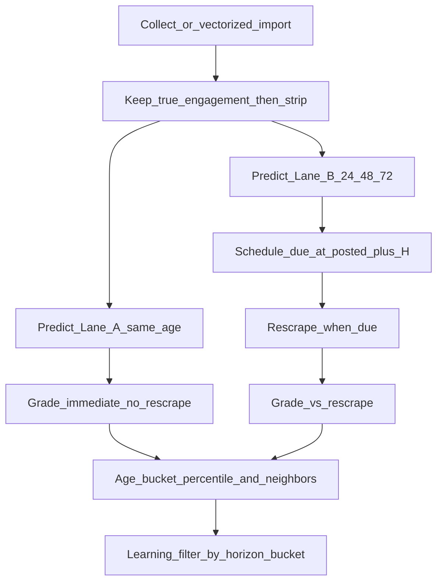

# Phase 11 — Multi-Horizon Age-Aware Validation

**Status:** Implemented (v1)  
**What it is:** Every validation prediction is graded only against engagement at its **stated horizon**. Same-age instant grades (Lane A) plus fixed 24h / 48h / 72h rescrape grades (Lane B), with age-bucketed percentiles, horizon-aware prompts, learning filters, and budget gates.

**Do not confuse with:** [Phase 8](Phase_8.md) letter phases A–J (feedback loop) or [Phase 9](Phase_9.md) A4 (parametric decay curves). Phase 11 **stores** multi-age graded points; A4 can fit curves later.

**Related:** [12_AGE_AWARE_VALIDATION.md](current%20md/12_AGE_AWARE_VALIDATION.md) (mode tags + forced_early filter) · [Phase 10 budget](phase_10/Phase_10.md) · validation under [`validation_pipeline/`](validation_pipeline/)

---

## Problem

A generic ~48h prediction target + force-validate / early backtest mixed immature actuals into learning as if they were mature outcomes. Age-aware mode only **excluded** bad rows; it did not make time part of the prediction.

**48h is one fixed horizon, not the only target.**

---

## Lanes

| Lane | Horizons | Predict | Grade |
|------|----------|---------|-------|
| **A — `same_age`** | `max(1, round(scraped_at − posted_at))` hours | Blind (engagement stripped); prompt targets that age | Immediate vs **pre-strip** engagement — **no Apify rescrape** |
| **B — `fixed_horizon`** | **24, 48, 72** hours | Blind; one DB row per horizon; prompt targets H | Due at `posted_at + H`; Apify rescrape; grade only that row |

Collect / vectorized import **auto-creates** Lane A + all three Lane B rows (subject to budget). No Due-immediately / Backtest checkboxes.

**Uniqueness:** `(linkedin_post_id, prediction_horizon_hours)` — integer hours.

---

## Age buckets

Used for actual percentiles, neighbor soft-prefer, and learning filters:

| Bucket id | Hours |
|-----------|-------|
| `0_6` | [0, 6) |
| `6_12` | [6, 12) |
| `12_24` | [12, 24) |
| `24_36` | [24, 36) |
| `36_48` | [36, 48) |
| `48_72` | [48, 72) |
| `72_168` | [72, 168) |
| `168_plus` | ≥ 168 |

If a bucket has fewer than **30** corpus posts with `engagement_age_hours` in range, percentile falls back to the full corpus (`percentile_source=corpus_fallback`).

---

## Runtime flow

---

## Tasks (T11.1–T11.8)

| ID | Work | Status |
|----|------|--------|
| **T11.1** | Schema: multi-horizon unique key, `prediction_lane`, `scraped_at_predict`; `posts.posted_at` / `engagement_age_hours`; store APIs | Done |
| **T11.2** | Age buckets + bucketed corpus percentile scoring | Done |
| **T11.3** | Horizon-aware predictor deps/prompt + age soft-prefer neighbors | Done |
| **T11.4** | Auto Lane A+B orchestration; worker rescrapes fixed horizons only | Done |
| **T11.5** | Horizon-bucket learning filters + eval stratification | Done |
| **T11.6** | Budget gate (`multi_horizon_predict`) + per-run max predicts | Done |
| **T11.7** | Collect/Queue UI + runbook notes | Done |
| **T11.8** | Tests | Done |

---

## Schema (summary)

**`predictions`**

- `prediction_horizon_hours` — required for new rows (legacy NULL backfilled to 48)
- `prediction_lane` — `same_age` \| `fixed_horizon`
- `scraped_at_predict` — when engagement was observed for Lane A
- Unique index: `(linkedin_post_id, prediction_horizon_hours)`

**`posts`**

- `posted_at TIMESTAMPTZ`
- `engagement_age_hours DOUBLE PRECISION` — age when engagement was measured

---

## Flags / settings

| Env | Default | Purpose |
|-----|---------|---------|
| `VALIDATION_MULTI_HORIZON_ENABLED` | `true` | Master switch for auto Lane A+B |
| `VALIDATION_MULTI_HORIZON_LEARNING` | `true` | Same-bucket only for cal / injection / eval |
| `VALIDATION_MULTI_HORIZON_MAX_PREDICTS_PER_RUN` | `40` | Cap Gemini predicts per Collect/import run |
| `VALIDATION_FIXED_HORIZONS_HOURS` | `24,48,72` | Lane B horizons |
| `VALIDATION_AGE_BUCKET_MIN_N` | `30` | Min posts before bucketed percentile (else fallback) |
| `VALIDATION_AGE_AWARE_ENABLED` | `false` | Existing forced_early exclusion (unchanged) |

Budget: job id `multi_horizon_predict` → Gemini daily/monthly caps (Phase 10 ledger). Priority when capped: **due Lane B rescrapes → Lane A → Lane B predicts (48, then 24, then 72)**.

---

## Operator notes

1. Import/collect creates up to **4 predictions per post** (1 same-age + 3 fixed) under the per-run + Gemini caps.
2. Lane A appears in Queue as **validated** immediately (no rescrape).
3. Lane B rows wait until `posted_at + horizon` (or are due immediately if already past).
4. Prefer turning `VALIDATION_MULTI_HORIZON_LEARNING=true` so 5h and 72h grades do not mix in calibration.
5. Populate `posts.posted_at` / `engagement_age_hours` on ingest for better bucketed neighbors; until then neighbors may be mixed-age with ages labeled in the prompt when known.

---

## Acceptance criteria

- [x] Same post can have multiple prediction rows at different horizons
- [x] Lane A grades without Apify using pre-strip engagement
- [x] Lane B due times follow `posted_at + H`
- [x] Predictor prompt includes horizon / posted_at / lane / neighbor ages
- [x] Actual percentile prefers same age bucket
- [x] Learning retrieve/cal can filter by horizon bucket
- [x] Budget can skip new predicts while allowing due rescrapes
- [x] Collect UI no longer requires Due immediately / Backtest for multi-horizon

---

## Out of scope

- Parametric decay-curve model (Phase 9 **A4**)
- Soft_blend / calibration prod GO (Phase F)
- Rewiring the live product draft eval path in one shot (reuse deps later)
