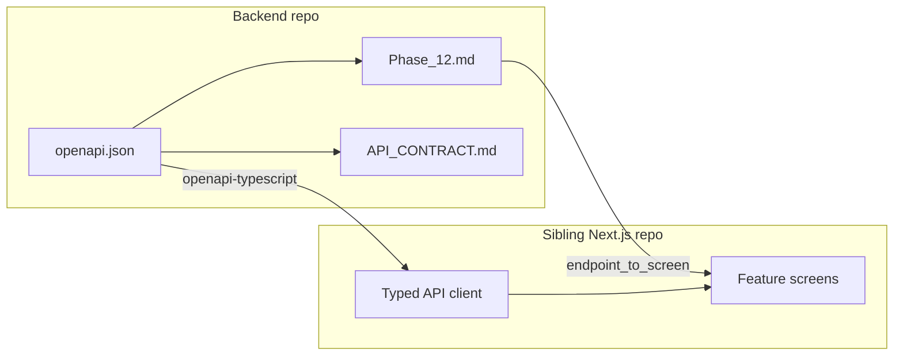

# Phase 12 — Frontend Product Foundation

**Status:** Doc milestone done — implementation **Not Started** (T12.1–T12.9 still open)  
**What it is:** Foundational setup for the **product** frontend — lock product scope, design tokens and component primitives, app shell, typed env + OpenAPI-backed API client. Separate from the Streamlit ops harness.

**Phase complete?** No. This file + the synced API contract are the Phase 12 **documentation** deliverable only. Full Phase 12 is done when T12.1–T12.9 acceptance criteria are met in the sibling Next.js repo.

**Do not confuse with:** [dashboard-for-devs](https://github.com/intotheopen/dashboard-for-devs) (ops/validation UI). That repo may share `data/` with this backend; the product frontend consumes **HTTP only** via FastAPI/OpenAPI.

**Related:** [`openapi.json`](openapi.json) (machine contract) · [`docs/api/API_CONTRACT.md`](docs/api/API_CONTRACT.md) · [`docs/api/VERSIONING.md`](docs/api/VERSIONING.md) · [`api/main.py`](api/main.py)

---

## Goal

Convert backend capabilities into a frontend MVP foundation: signed scope, route map, design system, accessibility baseline, Next.js repo standards, shell layout, fail-fast env config, and a typed API SDK — before feature-deep UI polish in later phases.

---

## Locked decisions

| Topic | Decision |
|-------|----------|
| Frontend stack | **Next.js App Router** + TypeScript + Tailwind CSS |
| Repo topology | **Sibling** frontend repo + Cursor **multi-root** workspace |
| Contract source of truth | Committed / live **`openapi.json`**; this doc + API_CONTRACT are human maps |
| AI / LLM provider | **Gemini only** (no OpenAI) — backend agents and any product-facing model config |
| First deliverable | Endpoint inventory + endpoint→screen map (T12.1 scaffolding) |

---

## Workspace setup (Developer + AI)

Recommended sibling layout:

```text
~/projects/
  intotheopen-backend/     # this repo
  intotheopen-frontend/    # new Next.js product app (T12.6)
```

In Cursor: **File → Add Folder to Workspace** (both roots) and save a `.code-workspace` file so agents can read OpenAPI + frontend code together.

```json
{
  "folders": [
    { "path": "intotheopen-backend" },
    { "path": "intotheopen-frontend" }
  ],
  "settings": {}
}
```

**AI awareness of endpoints**

1. Treat [`openapi.json`](openapi.json) as authoritative; regenerate TS types when it changes.
2. Point frontend rules / `AGENTS.md` at this file + `docs/api/API_CONTRACT.md`.
3. Do not invent routes — only `/health` and `/api/v1/*` listed below (never `/metrics` in the product client).

Local API base URL: `http://localhost:8000` (see API contract). Interactive docs: `/docs`.



---

## Stack (product frontend)

| Layer | Choice |
|-------|--------|
| Framework | Next.js App Router |
| Language | TypeScript (strict) |
| Styling | Tailwind CSS + CSS variable design tokens |
| Components | React primitives (+ Storybook in T12.4) |
| Routing | Next.js App Router file routes (T12.2) |
| Env validation | Zod (or equivalent) fail-fast (T12.8) |
| HTTP client | `fetch` + types from OpenAPI (T12.9) |
| Models | **Gemini** via this backend — frontend does not call OpenAI |

Client generation (from [`docs/api/VERSIONING.md`](docs/api/VERSIONING.md)):

```bash
# from frontend repo, path adjusted to sibling backend
npx openapi-typescript ../intotheopen-backend/openapi.json -o src/api/schema.d.ts

# or from a running API
curl -s localhost:8000/openapi.json -o openapi.json
npx openapi-typescript openapi.json -o src/api/schema.d.ts
```

---

## Tasks (T12.1–T12.9)

| ID | Work | Owner | Acceptance | Tools | Status |
|----|------|-------|------------|-------|--------|
| **T12.1** | Frontend Product Scope Freeze — convert backend capabilities into MVP scope; lock page list, journeys, edge cases, non-goals | Daniel | Approved PRD with signed scope, user flow map, and endpoint-to-screen mapping | Google Docs, FigJam, OpenAPI | Not Started |
| **T12.2** | Frontend Information Architecture — route tree, nav hierarchy, URL/query strategy, route guards | Daniel | Complete route map; no orphan pages; reproducible URL state | Next.js App Router, TypeScript | Not Started |
| **T12.3** | Design Token Foundation — typography, spacing, colors, radius, shadows, motion timing | Daniel | Tokenized theme global; no raw hardcoded design values in feature components | CSS variables, Tailwind config | Not Started |
| **T12.4** | Component Primitive Library — button, input, modal, table, toast, tabs, skeletons, badges, pagination | Daniel | Base set complete, documented, used by feature screens | React, TypeScript, Storybook | Not Started |
| **T12.5** | Accessibility Baseline — keyboard nav, focus, semantics, contrast on core flows | Daniel | Core screens pass a11y checks; no critical violations | axe-core, Lighthouse, semantic HTML | Not Started |
| **T12.6** | Frontend Repo and Standards Setup — strict TS, lint, format, folders, module boundaries | Daniel | CI passes lint + typecheck; conventions documented | TypeScript, ESLint, Prettier, GitHub Actions | Not Started |
| **T12.7** | Application Shell and Responsive Layout — desktop/mobile, persistent nav, route fallbacks | Daniel | Shell clean across viewports; stable route transitions | React, Tailwind CSS | Not Started |
| **T12.8** | Runtime Environment Configuration — typed env for API URLs, flags, telemetry; fail-fast | Erdal | Invalid env fails fast; safe dev/staging/prod switch | dotenv, Zod | Not Started (notes below) |
| **T12.9** | Typed API Client Layer — typed req/res, retry, timeout, unified errors | Erdal | All required endpoints integrated with consistent typed handling | fetch, TypeScript, openapi-typescript | Not Started (notes below) |

**Suggested build order after this doc:** T12.1 sign-off → T12.6 repo → T12.8 env → T12.9 client → T12.2/T12.7 shell → T12.3/T12.4/T12.5 design & a11y.

---

## T12.1 — Product scope freeze (draft for sign-off)

Daniel owns approval. Values below are **working defaults** until PRD is signed.

### Draft MVP page list

| Route (proposed) | Screen | Purpose |
|------------------|--------|---------|
| `/` | Home / Draft entry | Paste or write LinkedIn draft; primary CTA → Evaluate |
| `/evaluate` | Evaluation results | Predictor, diagnostics, variants from `/evaluate` |
| `/evaluate?tab=similar` | Similar posts panel | Evidence neighbors (`/similar-posts` or evaluate payload) |
| `/critique` | Audience critique | Standalone synthetic-audience critic |
| `/optimise` | Synthesis / optimise | Stage 5 maximizer / counter / brand_purist |
| `/agents` or settings chrome | Agent catalog | Discovery labels from `/agents` |
| — | Shell health badge (optional) | `GET /health` only |

### User journeys (draft)

1. **Primary — Evaluate draft:** User pastes content → `POST /api/v1/evaluate` → views prediction, diagnostics, variants → optionally opens similar posts.
2. **Assist — Similar only:** User requests neighbors without full cycle → `POST /api/v1/similar-posts`.
3. **Critique:** User runs audience critic → `POST /api/v1/critique` (does not mutate evaluate loop).
4. **Optimise:** User runs synthesis (optionally feeding objection from critique) → `POST /api/v1/optimise`.

### Edge cases (draft)

- Empty / too-short content → HTTP 422; map `loc` + `msg` to field errors
- Agent init failure → HTTP 503 with actionable detail (show retry + config hint)
- Partial evaluate success → `errors[]` non-empty; still render successful sections
- Rate limited → HTTP 429 when `API_RATE_LIMIT` is set (show backoff / retry)
- Auth on (prod): Bearer API key on **write/agent routes** (see Auth below); `user_id` must be authorized for tenant
- Do not render `query_embedding` in UI by default (large float array on evaluate)
- Similar posts after evaluate: prefer `EvaluateResponse.similar_posts` before a second `/similar-posts` call
- CORS: prefer Next.js rewrite/proxy until trusted-origin policy (#23) is deployed on the API target env

### Non-goals (Phase 12)

- Streamlit / dashboard-for-devs features (corpus ingest, validation lanes, feedback ops)
- Calling `/metrics` from the product UI
- OpenAI SDKs or OpenAI-hosted models
- Full account signup/login product (API keys / tenant principal until accounts land)
- Scaffolding beyond foundation (deep feature polish is later phases)

### Endpoint-to-screen mapping (default MVP)

| Screen / UI surface | Method | Path | Notes |
|---------------------|--------|------|-------|
| Draft / Evaluate | `POST` | `/api/v1/evaluate` | Primary journey |
| Results chrome / agent labels | `GET` | `/api/v1/agents` | UI discovery |
| Similar posts panel | `POST` | `/api/v1/similar-posts` | Or use `similar_posts` on evaluate response |
| Critique screen / side panel | `POST` | `/api/v1/critique` | Standalone; include in MVP unless T12.1 cuts to Phase 13+ |
| Optimise / synthesis screen | `POST` | `/api/v1/optimise` | Standalone; include in MVP unless T12.1 cuts to Phase 13+ |
| Shell health (optional) | `GET` | `/health` | Dev/ops probe; no auth |

---

## API contract for frontend (inventory)

**Authoritative schema:** [`openapi.json`](openapi.json). Human summary: [`docs/api/API_CONTRACT.md`](docs/api/API_CONTRACT.md). Versioning: [`docs/api/VERSIONING.md`](docs/api/VERSIONING.md).

| Method | Path | Purpose | Frontend MVP? |
|--------|------|---------|---------------|
| `GET` | `/health` | Liveness; `api_version: "v1"` | Dev/ops probe only |
| `GET` | `/api/v1/agents` | Agent catalog for UI discovery | Yes (settings / results chrome) |
| `POST` | `/api/v1/similar-posts` | Corpus similarity search | Yes (draft assist / evidence) |
| `POST` | `/api/v1/evaluate` | Full multi-agent evaluation cycle | Yes (**primary**) |
| `POST` | `/api/v1/critique` | Independent synthetic-audience critic | Yes if signed in T12.1; else Phase 13+ |
| `POST` | `/api/v1/optimise` | Independent Stage 5 synthesis | Yes if signed in T12.1; else Phase 13+ |

**Excluded from product contract:** `GET /metrics` (Prometheus).

**Auth:** When `API_AUTH_ENABLED=true`, these routes require `Authorization: Bearer <api_key>` via `require_api_principal`:

| Auth required when enabled | No auth dependency today |
|----------------------------|--------------------------|
| `POST /api/v1/similar-posts` | `GET /health` |
| `POST /api/v1/evaluate` | `GET /api/v1/agents` (rate-limited only) |
| `POST /api/v1/critique` | |
| `POST /api/v1/optimise` | |

Local/dev often leaves `API_AUTH_ENABLED=false`. Prefer a Next.js server-side proxy so the browser never holds long-lived API keys.

**Models:** Embeddings and agents use **Gemini** on the backend (`GEMINI_API_KEY`, agent model settings). Frontend never configures OpenAI.

---

## T12.8 — Runtime env (notes for frontend)

Typed, fail-fast validation (Zod). Suggested variables:

| Variable | Purpose |
|----------|---------|
| `NEXT_PUBLIC_API_BASE_URL` or server `API_BASE_URL` | Backend origin (`http://localhost:8000` local) |
| `API_BEARER_TOKEN` (server-only if proxying) | Bearer key when auth enabled |
| Feature flags | Gate critique/optimise screens, telemetry, etc. |
| Telemetry keys | Product analytics (separate from Prometheus `/metrics`) |

Invalid or missing required env must **fail at boot**, not at first click.

---

## T12.9 — Typed API client (notes)

- Generate types from OpenAPI (`openapi-typescript`)
- Unified error mapping: 422 `ValidationErrorResponse`, 500 `ApiErrorResponse` **or** transitional `{ detail }`, 503 agent config
- Retry/timeout policy for idempotent GETs and safe POSTs (product decision; document in frontend README)
- Integrate all MVP endpoints from the inventory table above

---

## Out of scope for the Phase 12 *doc* milestone

- Creating the Next.js GitHub repo or app scaffold (T12.6)
- Implementing CORS on FastAPI (#23)
- Changing backend routes or Gemini wiring
- Storybook / CI implementation (tracked under T12.4 / T12.6)

---

## Sign-off checklist (T12.1)

- [ ] Page list approved
- [ ] Journeys approved
- [ ] Edge cases / non-goals approved
- [ ] Endpoint→screen map signed (critique/optimise in or deferred)
- [ ] PRD linked here when ready: _(link TBD)_
