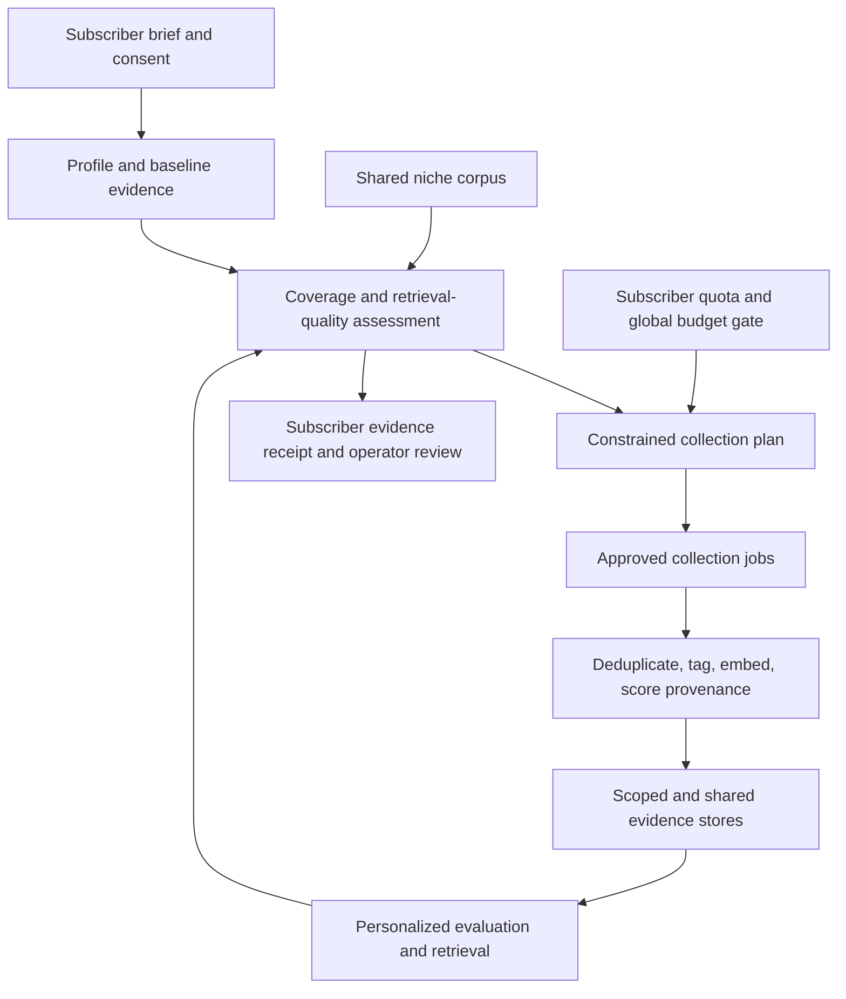

# Phase 19 - Subscriber Niche Personalization and Evidence Growth

**Status:** Releases A–B implemented. Releases C–D planned.  
**Builds on:** [Phase 10](phase_10/Phase_10.md) agentic scheduling, niche taxonomy, cost ledger, scrape proofs, and soft niche preference in retrieval.  
**Product premise:** A subscriber paying a premium price should receive analysis grounded in a growing body of relevant evidence for their actual market, voice, audience, and competitors - not a generic LinkedIn corpus with a niche label attached.

---

## Release A Implementation

Release A creates a consent-backed, reviewable baseline plan. It does **not** call Apify, queue a scrape, ingest any profile or post, or incur provider spend.

- Subscriber briefs persist a public HTTPS LinkedIn member-profile URL, explicit authorization, role, primary niche, sub-niche, audience, objectives, locale, and optional seed accounts.
- A submitted or revised brief produces an `apify` baseline proposal capped at **$10.00** and records the future maximum of **100 candidate posts per day**.
- The proposal deterministically prioritizes the subscriber public profile, approved seed accounts, niche queries, then shared niche evidence; it explains the proposed queries and why they were selected.
- The subscriber or operator approves the proposed plan explicitly. Revising a brief supersedes the previously approved plan and requires fresh approval.
- The API surface is `POST /api/v1/subscriber-evidence/briefs`, `GET /api/v1/subscriber-evidence/briefs/{subscriber_id}`, and `POST /api/v1/subscriber-evidence/briefs/{subscriber_id}/approve`.
- The persistent record is intentionally separate from the current global corpus, so the next release can attach provenance, scoped evidence membership, deletion, and collection receipts safely.

**Release A fix carried into B:** `subscriber_baseline_plans.brief_id` is no longer UNIQUE, so revise/supersede can keep plan history.

---

## Release B Implementation

Release B adds guarded automation: approved plans are executed by the Phase 10 agentic tick under fixed caps. Approval still does **not** scrape inline.

- Scoped evidence tables: items, membership (`subscriber_private` | `shared_niche`), collection jobs, receipts, and per-subscriber budget ledger.
- Collector runs profile → approved seeds → niche queries via Apify; stops at remaining **$10** baseline budget and **≤100 candidates/day**.
- Global Apify cap, brief pause, and plan approval are hard gates. New seed recommendations are recorded on jobs only — never auto-collected.
- Agentic job `subscriber_evidence` (flag kill switch) runs baseline first, then gap-driven daily refresh (coverage / freshness / diversity), with no-op when fresh.
- Spend is attributed through the Phase 10 cost ledger as `subscriber_evidence`.
- Retrieval prefers subscriber-private membership, then shared-niche membership / niche posts, then global soft-topic fallback.
- API additions: `POST .../pause`, `POST .../resume`, `GET .../receipts`, `GET .../jobs`.

**Deferred to Release C:** shared-niche batching economics across overlapping subscribers.
**Deferred to Release D:** adaptive coverage critic / cadence tuning from retrieval quality.

---

## The Outcome

For a subscriber in sports, the system should progressively build a sports-relevant evidence set around:

- Their own public LinkedIn activity and writing style.
- The niche they describe during signup, including sub-niche, audience, goals, geography, and role.
- Relevant peer, competitor, creator, company, and topic-level posts.
- The formats and themes that prove useful for evaluating that subscriber's drafts.

The result is a **subscriber evidence profile**, not a separate model or a permanently isolated vector database. It should combine a subscriber's private evidence with a healthy shared corpus, using global results whenever personal or niche evidence is too sparse.

---

## Product Principles

| Principle | Decision |
|---|---|
| Data ownership | Separate user-owned evidence from the shared corpus; do not accidentally expose one subscriber's posts to another. |
| Consent | Ask for a public LinkedIn profile URL and clear authorization to analyze publicly available material. Never request LinkedIn passwords, session cookies, or account access. |
| Niche depth | Start with a controlled taxonomy, but preserve the subscriber's free-text niche and sub-niche so it is not flattened into a broad label such as `sports`. |
| Cost control | Each subscriber has an explicit acquisition budget, quota, and stop condition. An agent cannot increase spend on its own. |
| Evidence first | New collection must improve coverage, freshness, or retrieval quality. More rows alone are not a success metric. |
| Shared learning | Reuse shared niche evidence where it is relevant; collect subscriber-specific evidence only where it adds real value. |
| Cold start | A new subscriber gets a bounded baseline collection, then falls back to the shared corpus until their specialized evidence is credible. |
| Human control | Early versions expose a reviewable collection plan and allow pause, edit, and delete actions. |

---

## Subscriber Journey

### 1. Onboarding: establish the evidence brief

During signup or the first product setup, collect:

| Input | Why it matters |
|---|---|
| Public LinkedIn profile URL | Identifies the subscriber's public content and author context. Validate ownership or authorization using a simple confirmation flow; do not collect credentials. |
| What they do | Produces a concise role, business, and expertise description. |
| Primary niche and sub-niche | Example: `sports` -> `football coaching` -> `academy growth`. This gives the initial taxonomy and search context. |
| Target audience | Distinguishes content for athletes, fans, sponsors, club owners, recruiters, or coaches. |
| Outcomes sought | Examples: authority, leads, sponsorships, recruitment, community, or thought leadership. |
| Geography and language | Limits irrelevant evidence and supports local-market context. |
| Known peers, competitors, and creators | Optional high-signal seed list, subject to platform and data-use policy. |
| Consent and controls | Clear approval for the baseline collection; controls to pause refresh, alter the brief, or delete personal data. |

The product should display the resulting brief back to the subscriber for confirmation. The initial niche is a hypothesis, not a permanent classification.

### 2. Baseline capture: buy enough evidence to be useful

On confirmation, run a one-time, tightly capped baseline collection. The working commercial target is approximately **$10 per subscriber** during the early rollout, but the system must use an actual provider-cost estimate and stop before the cap.

The baseline should prioritize quality over a fixed post count:

1. Collect the subscriber's recent public posts and available profile context.
2. Collect a small, targeted set from confirmed niche seeds: supplied accounts, well-matched peers, and query families derived from the brief.
3. Remove duplicates, low-content rows, stale or obviously irrelevant material, and content that cannot be safely used.
4. Tag the accepted evidence with broad niche, sub-niche candidates, audience, format, topic, author type, and freshness.
5. Produce an evidence receipt: what was collected, what was rejected, the estimated cost, coverage gaps, and the next proposed refresh date.

The output is sufficient to personalize retrieval and writing-style analysis, but it must retain global-corpus fallback while sample sizes are small.

### 3. Ongoing refresh: grow relevance rather than run a blind scrape

The initial operating target is **up to 100 candidate posts per subscriber per day**, not a guaranteed 100 accepted rows and not necessarily 100 direct profile scrapes. The scheduler should treat this as a maximum, then reduce or skip work when the prior evidence is fresh and sufficiently diverse.

The daily process selects the least expensive source that closes a meaningful gap:

- Recent posts from the subscriber's own approved public profile.
- Recent posts from explicitly approved high-signal accounts.
- Niche query results for the subscriber's sub-niche, audience, geography, and objectives.
- Shared niche collection when multiple subscribers need the same evidence.
- No collection when the current corpus is fresh, sufficiently broad, and returning strong matches.

Accepted evidence enters the subscriber's scoped corpus where appropriate; generally useful niche evidence can also enter the shared tagged corpus. The system must record provenance so later retrieval, deletion, and cost attribution remain possible.

---

## Agentic Operating Model

The agentic layer is a bounded planner and quality controller, not an autonomous scraper with permission to spend indefinitely.

### Agent roles

| Role | Responsibility | Boundaries |
|---|---|---|
| Brief interpreter | Turns onboarding answers into a normalized niche hypothesis, seed candidates, and search themes. | Suggests; does not overwrite subscriber-confirmed details without review. |
| Evidence planner | Detects missing coverage and proposes the next collection mix. | Works only within approved source types, per-user quota, and daily cap. |
| Collection router | Chooses shared-niche, profile, account, or keyword jobs and batches overlapping subscriber demand. | Cannot schedule work that is stale, duplicative, unapproved, or over budget. |
| Evidence curator | Deduplicates, classifies, scores relevance, records provenance, and rejects poor inputs. | Cannot promote an item solely because it is high engagement. |
| Coverage critic | Measures whether the current evidence set supports the subscriber's use cases. | Recommends gaps and confidence; it does not scrape or mutate the plan directly. |
| Budget and policy guard | Enforces provider caps, subscriber allocation, consent, retention, and source-policy rules. | Has veto power over all paid jobs. |
| Daily digest | Produces a concise operational record of what changed, why, cost, confidence, and unresolved gaps. | Read-only; no automatic expansion of budgets or access. |

### How the layer decides there is a gap

A collection job should require at least one measurable reason:

- **Freshness gap:** relevant evidence is older than the selected refresh window.
- **Coverage gap:** too few posts for a required sub-niche, audience, geography, format, or author type.
- **Retrieval gap:** draft evaluations frequently fall back to global results or return weak similarity/relevance.
- **Diversity gap:** the corpus is overly dominated by one account, format, or repeated topic.
- **Outcome gap:** later validation shows that a niche-specific evidence set predicts or critiques poorly.
- **Brief change:** the subscriber changes audience, role, offer, location, or strategic goal.

The layer should prefer a small targeted batch that resolves a named gap. It should not scrape simply because a daily schedule fired.

---

## Cost and Capacity Model

### Early premium-service model

Use the approximately $10 onboarding budget as a deliberately conservative learning allocation. It pays for enough initial evidence to test whether niche-aware evaluation is materially better than global-only evaluation.

| Stage | Collection posture | Commercial intent |
|---|---|---|
| Baseline | One bounded subscriber-specific capture, with a strict estimated-cost cap. | Make the service useful from the first session. |
| Early daily refresh | Up to 100 targeted candidates/day where gaps justify it. | Learn which sources and query types improve results. |
| Shared-niche scaling | Batch collection for overlapping niches and reuse shared evidence. | Reduce marginal cost as subscriber count grows. |
| Mature subscription | Include a transparent monthly evidence quota, with optional premium expansions. | Support a subscription priced in the hundreds without hidden, unlimited collection promises. |

### Allocation rules

1. Spend first on the subscriber's approved profile and highest-confidence gaps.
2. Reuse recent shared evidence before funding duplicate per-user collection.
3. Attribute every paid job to a subscriber, shared niche, or platform-level learning pool.
4. Stop at whichever arrives first: daily candidate cap, subscriber budget cap, global provider cap, or policy veto.
5. If a cap prevents collection, serve the best available evidence and surface lower confidence rather than silently claiming personalization.
6. Treat cost per useful accepted post, retrieval improvement, and evaluation improvement as primary metrics - not raw scraped-post volume.

---

## Evidence Architecture (Conceptual)

The future data model needs four separable layers:

| Layer | Purpose |
|---|---|
| Subscriber brief | Consent, public profile URL, declared niche, sub-niche, audience, objectives, locale, seeds, and controls. |
| Evidence items | Collected post/profile facts, normalized content, tags, embeddings, freshness, source, usage rights/policy metadata, and quality score. |
| Evidence membership | Whether an item belongs to a subscriber, a shared niche pool, or both; ensures deletion and access rules can be honored. |
| Collection ledger | Proposed plan, reason for collection, provider estimate, actual cost, job outcome, rejection reasons, and proof of coverage improvement. |

The retrieval layer should combine sources in this order when useful: subscriber-owned evidence, relevant shared niche evidence, then the global corpus. It must retain diversity and global fallback rather than narrowing to a thin personalized set.

---

## Major Workstreams

| ID | Workstream | Status | Planning intent | Definition of done |
|---|---|---|---|
| **T19.1** | Subscriber brief and consent | Release A complete | Persisted consent-backed brief, HTTPS LinkedIn member-profile validation, and revision/approval workflow. | A reviewed product and privacy specification; no credentials requested or stored. |
| **T19.2** | Niche profile model | Release A complete | Persisted primary niche, free-text sub-niche, audience, objectives, locale, and optional seeds. | A brief can be represented without losing important specialization. |
| **T19.3** | Baseline collection policy | Release A complete | Deterministic source priorities, hard $10 cap, 100-candidate ceiling, and reviewable proposed queries. | Every baseline run is bounded, attributable, explainable, and reviewable. |
| **T19.4** | Scoped evidence architecture | Release B complete | Plan subscriber/private versus shared-niche membership, provenance, retention, deletion, and retrieval order. | A data-governance design prevents cross-subscriber leakage. |
| **T19.5** | Gap-driven planner | Release B complete | Define coverage metrics, gap thresholds, job proposals, and no-op conditions. | The system can justify why each collection is needed. |
| **T19.6** | Daily collection scheduler | Release B complete | Design the up-to-100-candidate/day policy, batching across users, dedupe, freshness rules, and provider limits. | Scheduled work is targeted and does not create unbounded per-user scraping. |
| **T19.7** | Agentic controls and review | Release B complete | Approval is enforced for each new or revised baseline plan; pause/resume + job-flag kill switch; unusual seed recommendations stay approval-gated. | No agent can independently increase budget, sources, or access scope. |
| **T19.8** | Measurement and experiment plan | Planned | Compare global-only, shared-niche, and subscriber-specific retrieval/evaluation; quantify cost per improvement. | A decision framework exists before premium-scale rollout. |
| **T19.9** | Premium packaging | Planned | Define included evidence quota, refresh expectations, overage policy, and how confidence is communicated. | Product promises match actual cost and data availability. |

---

## Rollout Sequence

### Release A: Concierge baseline

Run a small set of subscriber briefs with human review of the proposed niche, source list, and baseline evidence receipt. Measure whether the resulting personalized evaluations are visibly and measurably better than global-only retrieval.

### Release B: Guarded automation

Automate planning, scheduled collection, deduplication, and receipts inside fixed cost and source controls. Keep new seed-account recommendations and unusual collection plans approval-gated.

**Implemented:** Apify execution under $10 / 100-candidate caps, Phase 10 `subscriber_evidence` tick job, scoped membership + receipts, pause/resume, and layered retrieval.

### Release C: Shared-niche economics

Batch collection where subscribers overlap, while preserving scoped personal evidence. Use observed reuse to reduce the marginal cost per subscriber and set evidence quotas that support the premium subscription price.

### Release D: Adaptive optimization

Allow the coverage critic to tune cadence and source mix within strict policies, based on retrieval quality and downstream validation. New sources, higher budgets, and policy changes remain operator-controlled.

---

## Success Measures

| Area | Measure |
|---|---|
| Relevance | Share of evaluation neighbors judged relevant to the subscriber's niche, audience, and goal. |
| Personal value | Improvement in draft-evaluation usefulness versus global-only retrieval. |
| Coverage | Fresh, diverse evidence across the subscriber's declared sub-niche and audience. |
| Efficiency | Cost per accepted useful post and cost per measurable evaluation improvement. |
| Reuse | Fraction of collection cost shared across subscribers in the same niche. |
| Safety | Zero cross-subscriber evidence exposure; all paid jobs traceable to consent and a budget decision. |
| Trust | Subscribers can see, correct, pause, and delete the inputs driving their personalization. |

---

## Explicit Non-Goals

- Do not build per-user fine-tuned models at this stage.
- Do not ask for LinkedIn credentials, cookies, or direct account-control access.
- Do not promise exactly 100 new useful posts every day; relevance, freshness, and policy matter more than volume.
- Do not create a separate always-on AI worker for every subscriber.
- Do not allow agents to expand spend, source scope, or subscriber access without fixed policy and human-approved controls.
- Do not replace the Phase 10 shared corpus; Phase 19 specializes and improves how it is used for premium subscribers.

---

## Decisions Needed Before Implementation

1. Which collection providers and source types are permitted for subscriber profiles, peer accounts, and keyword searches?
2. What does explicit subscriber authorization look like for analyzing a public LinkedIn profile, and what retention/deletion promises accompany it?
3. Is the early baseline budget a hard $10 ceiling, or a configurable target by subscription tier?
4. Does the up-to-100 daily cap apply to raw candidates, accepted posts, provider API results, or all of the above?
5. Which quality threshold establishes that personalized evidence is better than shared/global evidence before costs scale?
6. Which subscriber controls must be self-service at launch: pause, edit brief, remove a seed, delete personal evidence, export collection receipt?
