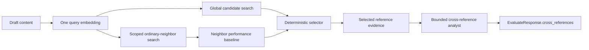

# Cross-Reference Evidence

**Status:** Implemented
**API publication:** v1.1.0
**Primary response field:** `EvaluateResponse.cross_references`

## Purpose

The evaluation pipeline now finds a small set of semantically close posts that
performed materially better than the draft's comparable-neighbor baseline. The
selected posts provide evidence for structural adaptation feedback. They are
not treated as causal proof, templates, or copy sources.

This feature addresses a specific gap in ordinary similarity retrieval:
nearest-neighbor posts are useful for grounding predictions, but they are not
necessarily strong examples. Cross-reference retrieval keeps prediction
neighbors and stronger global references as separate concepts.

## User-visible behavior

A successful evaluation may include `cross_references` with one of three
statuses:

| Status | Meaning | UI behavior |
| --- | --- | --- |
| `ready` | Deterministic evidence was selected and bounded analysis completed or is available | Render the Evidence section/tab |
| `insufficient_evidence` | No candidate met the semantic, performance, and quality thresholds | Explain that no sufficiently close stronger reference was found; do not substitute generic advice |
| `analysis_unavailable` | Evidence was selected, but the bounded analyst was unavailable | Render the selected evidence and availability caveat without invented adaptation advice |

The response is additive. Existing evaluation fields remain stable, and
`cross_references` may be `null` when the feature is disabled or the execution
path cannot produce it.

## Data flow



1. The draft is embedded once.
2. Ordinary neighbors are retrieved with the existing user/request scope and
   remain the source for prediction and diagnostics.
3. A separate global search supplies possible cross-reference candidates. A
   caller's tenant or user scope is never used to turn ordinary neighbors into
   global evidence.
4. The deterministic selector filters and ranks candidates.
5. The analyst receives only the selected evidence and may explain structural
   lessons from those posts.
6. The finalizer, variants, validation telemetry, synthesis runner, and API
   response carry the selected result forward.

## Deterministic selection policy

Selection is implemented in `agents/cross_reference.py` and is intentionally
independent of model output. A candidate must satisfy all applicable rules:

- It is semantically close enough to the draft according to cosine distance.
- Its performance clears the configured minimum uplift over the ordinary
  neighbor baseline.
- It has enough content to support a structural comparison.
- It is not marked as an engagement anomaly.
- It comes from the global candidate set, not merely from the ordinary
  prediction-neighbor set.

Audience-adjusted percentile is preferred when available. The selector falls
back to the available benchmark percentile only when the adjusted value is not
present. Candidates are ranked deterministically by performance uplift and
similarity, with stable identifiers used to break ties. At most three
references are returned by default.

The selected reference includes the source `SimilarPost`, normalized uplift,
selection facts, and optional analyst adaptation. The source content is
rendered as prompt-safe evidence and is not treated as an instruction.

## Bounded analyst

The analyst runs after prediction and diagnostics, so it can use the selected
evidence alongside the evaluation context without controlling selection. Its
contract is deliberately narrow:

- It may discuss only selected reference IDs.
- It returns bounded, structured feedback rather than an unrestricted rewrite.
- It must distinguish observable structure from causal claims.
- It must not reproduce source wording, recommend copying, or invent evidence.
- If evidence is unavailable, it returns no generic comparison advice.

If the model call fails, the selected deterministic evidence is retained and
the result becomes `analysis_unavailable`. This preserves useful evidence
without allowing a partial model failure to block the evaluation pipeline.

## Variants and synthesis

When `reembed_variant_neighbors` is enabled, every variant receives fresh
ordinary neighbors and a fresh global candidate search from its own embedding.
The variant predictor rerun therefore uses evidence that belongs to that
variant rather than reusing the original draft's retrieval context.

Internal retrieval preferences such as user scope and niche preference are
retained in evaluation state for this rerun but excluded from the public API.

Stage 5 synthesis accepts selected evidence only when it is explicitly supplied
by the caller or evaluation state. Ordinary caller-supplied neighbors are not
silently reclassified as global cross-reference evidence. Synthesis preserves
its stable `SynthesisResult` shape while using the evidence to inform bounded
scoring and feedback.

## API contract

The public contract is documented in:

- [`docs/api/API_CONTRACT.md`](../api/API_CONTRACT.md)
- [`docs/api/VERSIONING.md`](../api/VERSIONING.md)
- [`openapi.json`](../../openapi.json)

The v1.1.0 response addition is conceptually:

```json
{
  "cross_references": {
    "status": "ready",
    "baseline_percentile": 62.5,
    "references": [
      {
        "post": {
          "post_id": "post-123",
          "content": "..."
        },
        "uplift": 18.4,
        "selection_reason": "close_match_above_baseline",
        "analyst_adaptation": "Use a concrete problem-to-outcome transition."
      }
    ],
    "overall_feedback": [
      "The selected examples use a specific opening tension before introducing context."
    ],
    "caveats": [
      "Observed engagement is correlational and does not establish causation."
    ]
  }
}
```

The exact field types and optionality are authoritative in the OpenAPI
snapshot and Pydantic models. Clients should tolerate `null`, empty references,
and all three status values.

## Configuration

The feature is controlled by the following settings. Environment variables are
loaded by `config/settings.py`:

| Variable | Default | Purpose |
| --- | ---: | --- |
| `CROSS_REFERENCE_ENABLED` | `true` | Enable or disable global evidence |
| `CROSS_REFERENCE_CANDIDATE_LIMIT` | `30` | Number of global candidates to inspect |
| `CROSS_REFERENCE_MAX_REFERENCES` | `3` | Maximum selected references |
| `CROSS_REFERENCE_MIN_PERCENTILE_UPLIFT` | `10` | Required uplift over baseline |
| `CROSS_REFERENCE_MAX_COSINE_DISTANCE` | `0.25` | Maximum semantic distance |

The global search requires the existing embedding and vector-store services.
The analyst requires the configured Gemini credentials. Retrieval and
selection remain useful independently of the analyst when the model service is
unavailable.

## Failure and privacy boundaries

- Retrieval failure is recorded through the existing evaluation error path;
  it does not create fabricated evidence.
- Missing or weak candidates produce `insufficient_evidence`.
- Analyst failure produces `analysis_unavailable` with deterministic evidence
  preserved.
- User-scoped neighbors are not exposed as global cross-references.
- Query embeddings and internal retrieval preferences remain excluded from the
  product-facing evidence contract where the existing API marks them internal.
- Source posts are evidence for inspiration only. The system does not claim
  that their observed performance was caused by any single structural choice.

## Verification

The implementation has focused tests for selector policy, analyst constraints,
retrieval separation, orchestration, variants, validation telemetry,
synthesis, API schemas, and OpenAPI publication.

The last repository verification reported:

- Ruff: clean on touched implementation and test files.
- Editor diagnostics: no errors on touched paths.
- `git diff --check`: clean.
- Focused feature and API/OpenAPI tests: passing.
- Full suite: `750 passed, 5 failed`; the five failures are pre-existing Phase
  10 scheduler/pro-digest/feedback tests unrelated to cross-reference evidence.
- Live Gemini/Postgres validation was not run because usable credentials were
  unavailable in the local environment.
