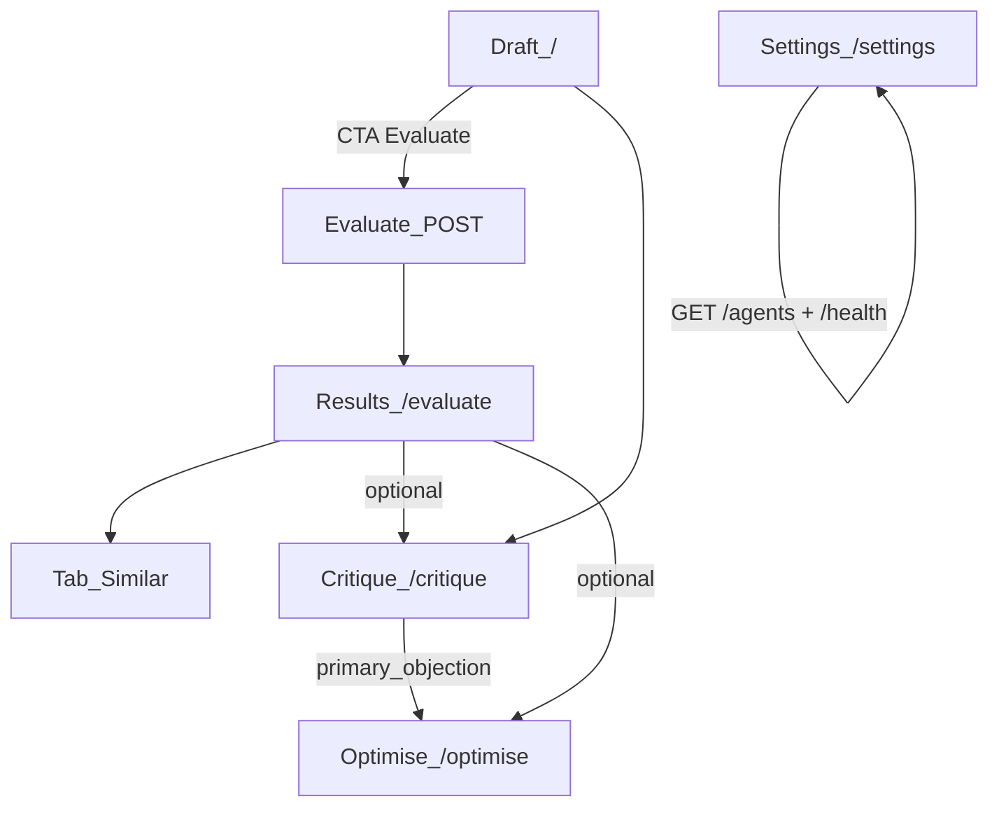

# T12.1 — Frontend Product Scope Freeze

**Status:** Frozen for engineering (in-repo PRD)
**Owner:** Daniel (formal product sign-off)
**Stack:** Next.js App Router + TypeScript + Tailwind (see [`Phase_12.md`](../../Phase_12.md))
**Contract:** [`openapi.json`](../../openapi.json) · [`API_CONTRACT.md`](../api/API_CONTRACT.md)

This document is the **approved working scope** for the product frontend MVP foundation. Engineering may proceed on T12.2+ against these decisions. Daniel can amend via PR; until then treat tables below as locked.

---

## 1. Product one-liner

IntoTheOpen helps a LinkedIn author paste a draft, see how it is likely to perform, understand why, and get stronger rewrites — powered by this backend’s Gemini agents over HTTP.

---

## 2. MVP capability → UI

| Backend capability | MVP UI treatment | Priority |
|--------------------|------------------|----------|
| `POST /api/v1/evaluate` | Primary workspace: prediction, diagnostics, evaluate-loop variants | P0 |
| `EvaluateResponse.similar_posts` | Evidence tab on results (no extra call by default) | P0 |
| `EvaluateResponse.cross_references` | Evidence tab: stronger close matches, normalized uplift, and bounded adaptation feedback | P0 |
| `POST /api/v1/similar-posts` | Optional “refresh neighbors” / draft-assist before evaluate | P1 |
| `GET /api/v1/agents` | Labels/icons in results chrome (not a standalone product page) | P1 |
| `POST /api/v1/critique` | Critique step / panel (3 lenses + score) | P1 — **in MVP** |
| `POST /api/v1/optimise` | Optimise step (3 synthesis variants + recommendation) | P1 — **in MVP** |
| `GET /health` | Dev/shell status only (optional) | P2 |
| `GET /metrics` | **Out of product** | — |

**Locked:** Critique and Optimise are **in MVP** as secondary flows after Evaluate. They are not deferred to Phase 13+.

---

## 3. Locked page list (no orphans)

| Route | Page | In nav? | Purpose |
|-------|------|---------|---------|
| `/` | Draft | Yes (primary) | Compose/paste draft; CTA **Evaluate** |
| `/evaluate` | Results | Yes | Show evaluate response; tabs for overview / similar / evidence / variants |
| `/critique` | Critique | Yes | Run audience critic on current or pasted draft |
| `/optimise` | Optimise | Yes | Run Stage 5 synthesis; can carry objection from critique |
| `/settings` | Settings | Yes (secondary) | Feature flags display, API health badge, agent catalog read-only |

**Removed from page list (by design):**

- Standalone `/agents` page → agent catalog lives under **Settings** + results chrome
- Standalone “Similar only” page → similar is a **tab on `/evaluate`** (plus optional refresh via API)

---

## 4. User flow map

### Journey A — Primary evaluate (must ship)

1. User lands on `/` with empty draft editor.
2. User pastes LinkedIn draft (≥ 1 character after trim; UI may suggest longer).
3. User clicks **Evaluate** → navigate to `/evaluate` with loading state.
4. App calls `POST /api/v1/evaluate` with `{ content, variant_strategy default "dimension" }`.
5. On 200: render predictor, diagnostics (`seo` / `clarity` / `tone`), variants; stash draft in URL or client state for return.
6. User opens **Similar** tab → render `similar_posts` from the same response (do **not** re-call unless they click Refresh).
7. User opens **Evidence** tab → render `cross_references` from the same response. Show selected source posts and adaptations only when references exist; otherwise explain that no direct higher-performing comparison was found.

### Journey B — Critique then optimise

1. From results or draft, user opens `/critique` (draft content carried via query `?draft=` short hash / session store — see T12.2; MVP may use `sessionStorage`).
2. `POST /api/v1/critique` → show `overall_verdict`, `score`, three lenses.
3. User clicks **Optimise with this objection** → `/optimise` prefilled with `primary_objection` from `c_suite.primary_objection`.
4. `POST /api/v1/optimise` → show three variants + `recommendation`; surface `errors[]` non-fatally.

### Journey C — Draft-assist similar (optional)

1. On `/`, before full evaluate, user clicks **Find similar** → `POST /api/v1/similar-posts`.
2. Show neighbor list; Evaluate remains the primary CTA.

### Journey D — Settings / discovery

1. User opens `/settings`.
2. `GET /api/v1/agents` populates agent list; optional `GET /health` shows API version badge.

---

## 5. Screen ↔ field map (what to render)

### `/evaluate` (from `EvaluateResponse`)

| UI block | Fields |
|---------|--------|
| Draft echo | `draft_content` |
| Prediction | `predictor_result.*` |
| Diagnostics cards | `diagnostics[seo|clarity|tone].{score,flaws,advantages,improvements}` |
| Variants list | `variants[].{variant_text,rationale,strategy_label,predicted_*}` |
| Similar tab | `similar_posts[]` |
| Evidence tab | `cross_references.{status,references,overall_feedback,caveats}` |
| Soft failures | `errors[]` toast/banner |
| Voice (if present) | `voice_profile` summary chip |
| Hidden | `query_embedding` (never render) |

### `/critique` (from `AudienceCriticOutput`)

| UI block | Fields |
|---------|--------|
| Summary | `overall_verdict`, `score` |
| C-suite | `c_suite.{reaction,primary_objection,roi_notes}` |
| Practitioner | `practitioner.{reaction,perceived_value,tactical_gaps}` |
| Peer | `peer.{reaction,credibility_check,originality_notes}` |

### `/optimise` (from `SynthesisResult`)

| UI block | Fields |
|---------|--------|
| Variants (3) | `variants[].{agent_id,variant_name,optimized_text,rationale,predicted_*,delta_percentile}` |
| Pick | `recommendation.{agent_id,reason}` |
| Context | `baseline_percentile`, `critic_objection_used` |
| Soft failures | `errors[]` |

---

## 6. Edge cases (locked UX)

| Case | Expected UX |
|------|-------------|
| Empty content | Client-side block + if API: 422 → field error from `detail[].loc/msg` |
| 503 agent init | Full-page error with retry; show `detail` string |
| 500 embed/server | Error banner; support both `ApiErrorResponse` and `{detail}` |
| 429 rate limit | Toast + disable CTA briefly; retry guidance |
| Partial evaluate (`errors[]`) | Render successful sections; list errors in non-blocking banner |
| Cross-reference evidence unavailable | Show the returned caveat; do not show invented comparison advice or a generic substitute |
| Auth enabled | Server-side proxy holds Bearer token; browser never stores long-lived keys |
| Cross-tenant `user_id` | MVP: omit `user_id` unless settings provide an authorized id |
| Long-running evaluate | Skeleton on results; timeout message (client timeout policy in T12.9) |
| Critique without draft | Disable Run until content present |
| Optimise without objection | Allowed — backend uses generic C-suite brief |
| Visual diagnostics / `image_url` | **Out of Phase 12 MVP UI** (API fields exist; do not expose controls yet) |
| Google Trends / seo_mode toggles | **Out of Phase 12 MVP UI** (use server defaults) |

---

## 7. Non-goals (Phase 12 product UI)

- Ops/validation: corpus ingest, multi-horizon lanes, feedback loop, Apify, Streamlit
- Account signup/login, OAuth, password reset
- Calling `/metrics` or showing Prometheus charts
- OpenAI client or model selection UI
- Exposing raw embeddings or DB internals
- Multi-user collaboration / org admin
- Mobile-native apps (responsive web only)
- Deep personalization UI for `user_id` / voice profile editing (read-only chip OK if API returns profile)

---

## 8. Endpoint-to-screen mapping (signed)

| Screen | Method | Path | When called |
|--------|--------|------|-------------|
| Draft → Results | `POST` | `/api/v1/evaluate` | Evaluate CTA |
| Results → Similar refresh | `POST` | `/api/v1/similar-posts` | Explicit refresh only |
| Draft assist | `POST` | `/api/v1/similar-posts` | Optional pre-evaluate |
| Critique | `POST` | `/api/v1/critique` | Run critique |
| Optimise | `POST` | `/api/v1/optimise` | Run optimise |
| Settings / chrome | `GET` | `/api/v1/agents` | Mount settings / label map |
| Settings badge | `GET` | `/health` | Optional |

---

## 9. Carry-state rules (for T12.2)

Implemented in [`T12.2_INFORMATION_ARCHITECTURE.md`](T12.2_INFORMATION_ARCHITECTURE.md). Summary:

| State | MVP approach |
|-------|----------------|
| Current draft text | `sessionStorage` key `ito.draft` + optional `?from=evaluate` |
| Last evaluate payload | `sessionStorage` key `ito.lastEvaluate` (do not put huge embeddings in URL) |
| Critique objection | `sessionStorage` key `ito.primaryObjection` when navigating to optimise |
| Variant strategy | Default `dimension`; advanced control can wait for Phase 13 |

URL query for shareable results is **non-goal for Phase 12** (no public share links).

---

## 10. Acceptance (T12.1)

| Criterion | Met? |
|-----------|------|
| Page list locked (no orphan pages) | Yes — §3 |
| User flow map | Yes — §4 |
| Edge cases + non-goals | Yes — §6–7 |
| Endpoint-to-screen mapping | Yes — §8 |
| Critique/optimise in or out decided | **In MVP** — §2 |
| In-repo PRD | This file |
| Daniel formal sign-off (checkbox) | Pending |

**Engineering may start T12.2** against this freeze. If Daniel changes scope, update this file in the same PR as route changes.

---

## Sign-off

| Role | Name | Date | Signature |
|------|------|------|-----------|
| Product (Daniel) | | | ☐ Approved |
| Eng reference | | 2026-08-03 | Scope frozen in-repo for build |
