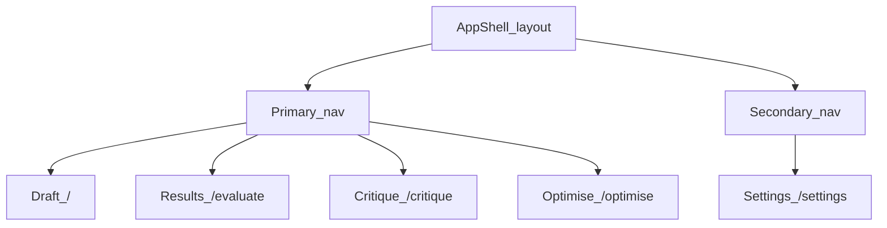

# T12.2 — Frontend Information Architecture

**Status:** Done (in-repo IA) — implement in Next.js under T12.6 / T12.7
**Depends on:** [`T12.1_PRODUCT_SCOPE_FREEZE.md`](T12.1_PRODUCT_SCOPE_FREEZE.md)
**Stack:** Next.js App Router + TypeScript

Acceptance: complete route map, no orphan pages, reproducible URL state, nav hierarchy, route-guard behavior.

---

## 1. Route tree (App Router)

Every T12.1 page maps to exactly one App Router segment. No extra product routes.

```text
app/
  layout.tsx                 # App shell (T12.7): nav + main + fallbacks
  page.tsx                   # /          Draft
  evaluate/
    page.tsx                 # /evaluate  Results (+ tabs via searchParams)
  critique/
    page.tsx                 # /critique
  optimise/
    page.tsx                 # /optimise
  settings/
    page.tsx                 # /settings
  not-found.tsx              # Unknown paths → soft 404 + link home
  loading.tsx                # Optional root route loading UI
  error.tsx                  # Route-level error boundary
```

### Canonical paths

| Path | Page id | File | Nav label |
|------|---------|------|-----------|
| `/` | `draft` | `app/page.tsx` | Draft |
| `/evaluate` | `evaluate` | `app/evaluate/page.tsx` | Results |
| `/critique` | `critique` | `app/critique/page.tsx` | Critique |
| `/optimise` | `optimise` | `app/optimise/page.tsx` | Optimise |
| `/settings` | `settings` | `app/settings/page.tsx` | Settings |

### Explicitly not routed (orphans forbidden)

| Path / idea | Why excluded |
|-------------|--------------|
| `/agents` | Catalog lives in Settings + results chrome (T12.1) |
| `/similar` | Similar is `?tab=similar` on `/evaluate` |
| `/login`, `/signup` | Non-goal Phase 12 |
| `/metrics` | Ops only; never product |

Unknown URLs → `not-found.tsx` (not a silent redirect that hides bad links).

---

## 2. Navigation hierarchy



| Slot | Items | Behavior |
|------|-------|----------|
| **Primary** (left / top) | Draft, Results, Critique, Optimise | Always visible desktop; hamburger / bottom bar mobile (T12.7) |
| **Secondary** | Settings | Trailing / footer of nav |
| **In-page** (Results only) | Overview \| Similar \| Evidence \| Variants | Controlled by `?tab=` — not separate nav items |
| **Contextual CTAs** | Evaluate, Find similar, Optimise with objection | Buttons that navigate + write session state |

**Active state:** match pathname exactly (`/` only for draft; `/evaluate` active for all evaluate tabs).

---

## 3. URL and query strategy

### Principles

1. **URLs are for navigation + lightweight UI state** (which tab).
2. **Payloads stay in `sessionStorage`** (draft text, last evaluate JSON without embeddings, objection) — never put draft bodies or embedding vectors in the query string.
3. **No shareable result URLs in Phase 12** (T12.1 §9).

### Allowed search params

| Route | Param | Values | Default | Reproducible? |
|-------|-------|--------|---------|---------------|
| `/evaluate` | `tab` | `overview` \| `similar` \| `evidence` \| `variants` | `overview` | Yes — bookmark restores tab |
| `/` | `from` | `evaluate` \| `critique` \| `optimise` | omit | Soft hint only (focus editor) |
| `/critique` | _(none MVP)_ | — | — | Draft from `ito.draft` |
| `/optimise` | `source` | `critique` \| `evaluate` \| `manual` | `manual` | Yes — explains prefill source |
| `/settings` | _(none)_ | — | — | — |

**Invalid `tab` / `source`:** coerce to default; do not 404.

### Session storage keys (locked names)

| Key | Type (conceptual) | Written by | Read by |
|-----|-------------------|------------|---------|
| `ito.draft` | `string` | Draft editor, Evaluate success | All feature pages |
| `ito.lastEvaluate` | evaluate JSON **minus** `query_embedding` | Evaluate success | `/evaluate`, Optimise baselines |
| `ito.primaryObjection` | `string` | Critique “Optimise with objection” | `/optimise` |
| `ito.lastCritique` | critique JSON (optional) | Critique success | `/critique` re-entry |
| `ito.lastOptimise` | synthesis JSON (optional) | Optimise success | `/optimise` re-entry |

Strip `query_embedding` before `JSON.stringify` into `ito.lastEvaluate`.

### Navigation recipes

| User action | Write state | Navigate to |
|-------------|-------------|-------------|
| Evaluate CTA | `ito.draft`; clear stale errors | `/evaluate` (show loading → POST) |
| Open Similar tab | — | `/evaluate?tab=similar` |
| Open Evidence tab | — | `/evaluate?tab=evidence` |
| Open Variants tab | — | `/evaluate?tab=variants` |
| Critique from Results | ensure `ito.draft` | `/critique` |
| Optimise with objection | `ito.primaryObjection` | `/optimise?source=critique` |
| Optimise from Results | optional baselines from `ito.lastEvaluate` | `/optimise?source=evaluate` |
| Edit draft again | — | `/?from=evaluate` |

---

## 4. Route guards

No account login in Phase 12. Guards are **soft product gates**, not auth middleware.

| Guard | Applies | Rule | UX |
|-------|---------|------|----|
| **G1 Draft required** | `/critique` Run, `/optimise` Run, Evaluate CTA | `ito.draft` trim length ≥ 1 | Disable primary CTA + inline hint; still allow viewing empty page shell |
| **G2 Results empty** | `/evaluate` | No `ito.lastEvaluate` and not mid-flight | Empty state: “Run Evaluate from Draft” → link `/` |
| **G3 Tab without data** | `/evaluate?tab=similar` / `?tab=evidence` | Similar posts or cross-reference evidence empty | Similar: empty list + optional Refresh. Evidence: show returned insufficient-evidence caveat; do not create generic advice. |
| **G4 Objection optional** | `/optimise` | Missing `ito.primaryObjection` | Allowed; show “using generic brief” |
| **G5 Auth proxy** | All API POSTs | Bearer only on server (T12.8/T12.9) | No client-side redirect to login |
| **G6 Feature flags** | `/critique`, `/optimise` | If flag off (T12.8) | Hide nav item + `notFound()` or disabled empty page |

**Next.js note:** Prefer client checks + empty states for G1–G4. Use `middleware.ts` only later if you need host/CORS or flag redirects — not required for MVP.

---

## 5. Typed route helpers (copy into frontend at T12.6)

```ts
// src/lib/routes.ts — implement under T12.6; contract locked here

export const APP_PATHS = {
  draft: "/",
  evaluate: "/evaluate",
  critique: "/critique",
  optimise: "/optimise",
  settings: "/settings",
} as const;

export type AppPath = (typeof APP_PATHS)[keyof typeof APP_PATHS];

export type EvaluateTab = "overview" | "similar" | "evidence" | "variants";
export type OptimiseSource = "critique" | "evaluate" | "manual";

export const SESSION_KEYS = {
  draft: "ito.draft",
  lastEvaluate: "ito.lastEvaluate",
  primaryObjection: "ito.primaryObjection",
  lastCritique: "ito.lastCritique",
  lastOptimise: "ito.lastOptimise",
} as const;

export function evaluateHref(tab: EvaluateTab = "overview"): string {
  if (tab === "overview") return APP_PATHS.evaluate;
  return `${APP_PATHS.evaluate}?tab=${tab}`;
}

export function optimiseHref(source: OptimiseSource = "manual"): string {
  if (source === "manual") return APP_PATHS.optimise;
  return `${APP_PATHS.optimise}?source=${source}`;
}

export function parseEvaluateTab(raw: string | null | undefined): EvaluateTab {
  if (raw === "similar" || raw === "evidence" || raw === "variants" || raw === "overview") return raw;
  return "overview";
}

export function parseOptimiseSource(raw: string | null | undefined): OptimiseSource {
  if (raw === "critique" || raw === "evaluate" || raw === "manual") return raw;
  return "manual";
}

export const PRIMARY_NAV = [
  { id: "draft", href: APP_PATHS.draft, label: "Draft" },
  { id: "evaluate", href: APP_PATHS.evaluate, label: "Results" },
  { id: "critique", href: APP_PATHS.critique, label: "Critique" },
  { id: "optimise", href: APP_PATHS.optimise, label: "Optimise" },
] as const;

export const SECONDARY_NAV = [
  { id: "settings", href: APP_PATHS.settings, label: "Settings" },
] as const;
```

---

## 6. Orphan / consistency check

| T12.1 page | T12.2 route | Nav entry | Guard |
|------------|-------------|-----------|-------|
| Draft | `/` | Primary | G1 on CTAs |
| Results | `/evaluate` | Primary | G2, G3 |
| Critique | `/critique` | Primary | G1, G6 |
| Optimise | `/optimise` | Primary | G1, G4, G6 |
| Settings | `/settings` | Secondary | — |

All T12.1 pages covered; no extra product pages. **Pass.**

---

## 7. Loading and error routes

| File | Behavior |
|------|----------|
| `app/evaluate/loading.tsx` | Skeleton while client kicks off evaluate (T12.7) |
| `app/error.tsx` | Catch render errors; Retry + Home |
| `app/not-found.tsx` | Unknown path; link to Draft |

API failures (422/429/500/503) are **page-local** banners (T12.1 §6), not `error.tsx`, unless an unexpected throw escapes.

---

## 8. Acceptance (T12.2)

| Criterion | Met? |
|-----------|------|
| Complete route map | Yes — §1 |
| No orphan pages vs T12.1 | Yes — §6 |
| Nav hierarchy | Yes — §2 |
| Reproducible URL state (`tab`, `source`) | Yes — §3 |
| Route guard behavior | Yes — §4 |
| Typed path helpers for T12.6 | Yes — §5 |

**Next:** T12.6 scaffold Next.js repo using this file tree, then T12.7 shell wiring nav to `PRIMARY_NAV` / `SECONDARY_NAV`.
