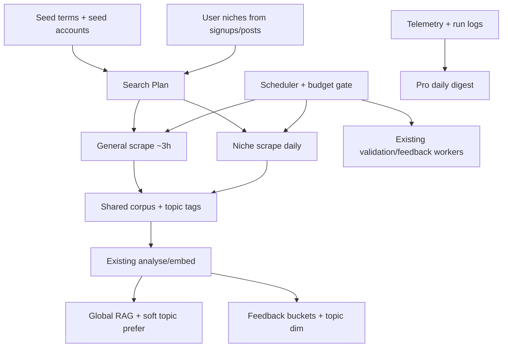

# Phase 10 — Agentic Layer (Background Automation)

**Status:** Planning  
**Owner (sheet):** TBD (diagram: Erdal agentic layer)  
**Folder:** [`phase_10/`](.)  
**Models:**
- Product path (eval, diagnostics, variants, hybrid feedback): Gemini Flash / `gemini-2.5-flash-lite` via `AGENT_GEMINI_MODEL`
- Meta “dev AI” digest only: **Gemini Pro**

**Principle:** Do **not** remake scrape / analyse / embed / validate / feedback / eval. New code is thin: **search plan + scheduler + budget gate + topic routing + Pro digest + Agentic Layer tab** that **calls** existing modules.

**Related (already built):**
- Scrapers: [`scrapers/`](../scrapers/)
- Processors / collection: [`processors/`](../processors/)
- Validation: [`validation_pipeline/`](../validation_pipeline/)
- Feedback loop: [`feedback/`](../feedback/)
- Telemetry / cost: [`telemetry/`](../telemetry/)
- Live eval cycle: [`agents/orchestrator.py`](../agents/orchestrator.py)
- Dashboard pages 1–10 under [`dashboard/pages/`](../dashboard/pages/)

**Related phases:**
- [Phase 7](../Phase_7.md) — on-demand multi-agent evaluation (T7.1–T7.16)
- Phase 8 — feedback loop (learn from real outcomes)
- Phase 9 — independent offline modules (A1–A4)

---

## What this phase is

Turn the diagram hub **“Automated feedback system first proposed (agentics)”** into a **scheduled, cost-gated background layer**:

1. Keep the corpus fresh (general scrape on a timer).
2. Adapt scrape targets from **seed terms/accounts**, then **user niches** (so a fintech-only user base does not keep scraping sports).
3. Add a **topic** dimension to feedback buckets.
4. Keep **one global RAG** with optional soft topic preference (no separate niche vector index).
5. Run a daily **Pro** “dev AI” that reads logs/telemetry and suggests what to change (read-only first).
6. Expose ops controls in a new dashboard tab: **Agentic Layer**.

Not an always-on LLM. Jobs on a schedule; Flash for product; Pro for the meta digest only.

---

## Background pipeline

---

## Design locks

| Decision | Choice |
|----------|--------|
| Always-on LLM | **No** — scheduled jobs only |
| Cadence | General **~every 3 hours**; niche **daily**; Pro digest **daily** |
| Models | Flash = product path; **Pro = T10.10 only** |
| Niche RAG | **No** separate niche index; soft topic prefer (T10.8) |
| What dictates search | Seed terms/accounts **then** user-derived plan (T10.2) |
| Multi-instance per user type | **No** — one worker pool, niche-keyed jobs |
| UI | New **Agentic Layer** tab (T10.1); call existing code |
| Code reuse | Thin wrappers / jobs; no forked scrape or eval pipelines |

---

## Task index

| ID | Name | Status | Depends on | Notes |
|----|------|--------|------------|-------|
| **T10.1** | Agentic Layer Dashboard Tab | **Partial** | T10.2, T10.3, T10.9, T10.10 (partial OK earlier) | UI live; plan wired; schedule/budget/digests stub |
| **T10.2** | Search Plan Service | **Done** | T10.6 (for weights) | Postgres `agentic_search_plan` + rebuild |
| **T10.3** | Scheduler + Budget Gate | Planning | T10.9 | Cron/worker tick; not always-on |
| **T10.4** | General Corpus Refresh Job | Planning | T10.2, T10.3 | Reuses `scrapers/` + processors |
| **T10.5** | Niche Scrape Job (demand-driven) | Planning | T10.2, T10.3, T10.6 | Daily; skip idle niches |
| **T10.6** | Topic Taxonomy + Tagging | **Done** | — | Enum + `posts.niche` + `user_niches` |
| **T10.7** | Topic Dimension on Feedback Buckets | Planning | T10.6 | Extend `feedback/routing.py` + fallback |
| **T10.8** | Soft Topic Preference in RAG | Planning | T10.6 | Global `find_similar` only |
| **T10.9** | Cost Control Ledger | Planning | — | Apify + Gemini caps for agentic jobs |
| **T10.10** | Dev AI Workflow Critic (Pro) | Planning | T10.3, T10.9 | Read-only digests first |
| **T10.11** | Worker Wiring (validation + feedback) | Planning | T10.3 | Schedule existing CLIs |

**Counts:** Planning 8 · Partial 1 · Done 2.

---

## Sheet rows (tracker copy-paste)

| Phase | ID | Name | Owner | Description | Acceptance / outputs | Stack | Status |
|-------|-----|------|-------|-------------|----------------------|-------|--------|
| Phase 10 | **T10.1** | Agentic Layer Dashboard Tab | TBD | New Streamlit page **Agentic Layer**: configure seed search terms + seed accounts, view derived search plan / niche weights, budget used, last/next runs, start-stop flags, Pro digests. Ops UI only — no duplicated scrape/eval logic. | Tab live under dashboard; all actions call shared services/jobs; shows plan, runs, costs, digests. | Streamlit / Python | **Partial** |
| Phase 10 | **T10.2** | Search Plan Service | TBD | Single source of truth for “what do we scrape?”. Layers: (1) operator **seed terms**, (2) optional **seed LinkedIn accounts** (bootstrap / simulate), (3) **user-derived niche weights** from signed-up users’ posts. If all users are fintech, sports weight → 0 (or absent). | Persisted `search_plan` (terms, weights, niche ids, updated_at); helpers to read plan for jobs; seed editable from T10.1. | Python / PostgreSQL | **Done** |
| Phase 10 | **T10.3** | Scheduler + Budget Gate | TBD | Cron/systemd (or worker tick): **~every 3h** general refresh; **daily** niche refresh for niches with demand / active users; optionally tick existing validation + feedback workers. **Not** always-on LLM. Before each paid step, enforce daily/monthly Apify + Gemini ceilings; priority: validation rescrape > niche (active) > general. | Jobs enqueue only when under budget; skipped runs logged with reason; schedule intervals configurable. | Python / Linux Cron / PostgreSQL | Planning |
| Phase 10 | **T10.4** | General Corpus Refresh Job | TBD | Thin job: load search plan → call **existing** Apify post scrape + collection/analyse/embed path. Dedup / staleness so “newest” is incremental, not full re-scrape. | Posts land in shared corpus with topic tags; telemetry + Apify cost recorded; reuses `scrapers/` + processors (no fork). | Python / Apify / PostgreSQL | Planning |
| Phase 10 | **T10.5** | Niche Scrape Job (demand-driven) | TBD | Daily: for each niche with user demand (or simulate weights), scrape niche keywords into shared corpus **tagged by topic**. Per active user = ensure their niche refreshed, **not** one AI process per user. | Niche-tagged posts ingested; idle niches skipped; cost attributable per niche in telemetry. | Python / Apify / PostgreSQL | Planning |
| Phase 10 | **T10.6** | Topic Taxonomy + Tagging | TBD | Coarse topic set (~8–12: e.g. sports, saas_b2b, fintech, creator, finance, health, career, marketing, other). Tag posts at analyse/ingest; infer **user niche profile** from their posts for T10.2 weights. Reuse analyser `topic` where present. | Stable topic enum; posts tagged; `user_niches` (or similar) drives plan weights. | Python / PostgreSQL | **Done** |
| Phase 10 | **T10.7** | Topic Dimension on Feedback Buckets | TBD | Extend `feedback/routing.py` metadata cluster from `{length}_{format}_{followers}` → `{topic}_{length}_{format}_{followers}`. Fallback when N &lt; `validation_cluster_n_min`: topic+shape → shape-only → global. Update labels / centroid path so Phase H does not break. | New cluster ids in feedback store; sparse niches still get lessons via fallback; tests for routing + fallback. | Python / PostgreSQL | Planning |
| Phase 10 | **T10.8** | Soft Topic Preference in RAG | TBD | Keep **one global** `find_similar`. Optional re-rank / mix: prefer same-topic neighbors when available; **never** hard-filter to niche-only index (avoids cold-start / thin buckets). | Eval neighbors can bias to topic without separate niche vector DB; empty niche → pure global. | Python / pgvector | Planning |
| Phase 10 | **T10.9** | Cost Control Ledger | TBD | Persist daily Apify + Gemini spend for agentic jobs; wire caps into T10.3. Reuse `telemetry/` pricing helpers; extend caps beyond feedback-LLM-only. | Dashboard shows spend vs cap; jobs no-op when over budget; warnings in digests. | Python / PostgreSQL | Planning |
| Phase 10 | **T10.10** | Dev AI Workflow Critic (Pro) | TBD | Scheduled **daily** meta-agent: read telemetry, scrape-plan stats, validation MAE, feedback queue, errors. **Gemini Pro only**. Output: digest of what might need changing (config, keywords, caps, failing niches). Read-only first — no auto-mutate prompts/flags. | Digest stored + shown on Agentic Layer tab (and optional notify); uses Pro; Flash unchanged for product agents. | Python / Gemini Pro / PostgreSQL | Planning |
| Phase 10 | **T10.11** | Worker Wiring (reuse validation + feedback) | TBD | Register existing `validation_pipeline` + `feedback` worker CLIs on the same scheduler so agentic layer is an automated working way of what we already have, not a parallel loop. | Cron / job runner invokes existing CLIs; runbook updated; no duplicated validate/learn logic. | Python / Linux Cron | Planning |

---

## Task briefs

### T10.1 — Agentic Layer Dashboard Tab

**Status:** Partial (UI live; backends stubbed)

**What:** New Streamlit page named **Agentic Layer**. Control and observe the background system; do not reimplement scrapers or eval.

**Surfaces:**
- Edit seed search terms and seed LinkedIn accounts
- View derived search plan (terms, niche weights, last updated)
- Budget used vs caps; last/next scheduled runs
- Start/stop or enable/disable job flags
- Latest Pro digests (T10.10)

**Do not:** Duplicate Scraper Stage / Evaluation Cycle logic — call shared services and job entrypoints.

**Shipped (T10.1 stub slice):**
- Nav: **Agentic → Agentic layer** via [`dashboard/app.py`](../dashboard/app.py) + [`dashboard/pages/11_Agentic_Layer.py`](../dashboard/pages/11_Agentic_Layer.py)
- Package: [`phase_10/`](.) — small modules (`search_plan`, `job_flags`, `budget`, `schedule`, `digests`) + [`phase_10/ui/`](ui/) panels
- Persist: seeds/weights in Postgres `agentic_search_plan` (JSON seeds migrated once); job flags still `data/agentic_job_flags.json`
- Contracts: frozen dataclasses in [`models.py`](models.py)

**Still stubbed on tab:** last/next runs (T10.3), ledger caps/attribution (T10.9), Pro digests (T10.10)

---

### T10.2 — Search Plan Service

**Status:** Done

**What:** Answers “what should the scraper search?”

| Layer | Source | Role |
|-------|--------|------|
| 1. Seed | Operator (tab / config) | Bootstrap before real users |
| 2. Seed accounts | Operator LinkedIn URLs | Simulate / warm corpus |
| 3. User-derived | Signups + their posts → niches | Long-run mix; idle niches drop out |

**Shipped:**
- Table `agentic_search_plan` (singleton) + [`search_plan_store.py`](search_plan_store.py) / [`search_plan.py`](search_plan.py)
- `rebuild_search_plan()` → [`user_niches.refresh_user_niches`](user_niches.py) → global weights (primary niche per user)
- Job helpers: `queries_for_general_refresh`, `active_niches`, `seed_profile_urls`
- Agentic **Rebuild plan** button; empty weights when no subscriber-tagged posts

**Output shape:** `{ terms[], weights_by_niche{}, seed_accounts[], updated_at }` with `stub=False`.

---

### T10.3 — Scheduler + Budget Gate

**Cadence:**
- ~every **3 hours** — general corpus refresh (T10.4)
- **daily** — niche scrapes (T10.5)
- **daily** — Pro digest (T10.10)
- existing validation / feedback workers via T10.11

**Budget priority when near cap:** validation rescrape → active niche → general freshness.

Skip + log when over daily/monthly Apify or Gemini ceilings (T10.9).

---

### T10.4 — General Corpus Refresh Job

Thin wrapper: `search_plan` → existing Apify keyword scrape → existing collect / analyse / embed. Incremental (dedup / staleness). Tag topics (T10.6).

---

### T10.5 — Niche Scrape Job (demand-driven)

Daily job per niche with demand (or simulate weights from seed). Same scrape stack as T10.4; posts tagged with niche topic. **Not** one OS process / “agent instance” per user type — niche-keyed jobs on one pool.

---

### T10.6 — Topic Taxonomy + Tagging

**Status:** Done

Coarse enum in [`topics.py`](topics.py) (~10 niches). Tag at analyse/finalize via [`tagging.apply_niche`](tagging.py) → `posts.niche` (free-text `topic` unchanged). Maintain `user_niches` for plan weights. Backfill: `python -m phase_10.backfill_niches`.

---

### T10.7 — Topic Dimension on Feedback Buckets

Today ([`feedback/routing.py`](../feedback/routing.py)):

`{length}_{format}_{followers}` → e.g. `medium_list_micro`

Target:

`{topic}_{length}_{format}_{followers}` → e.g. `fintech_medium_list_micro`

**Fallback when cluster N too low:** topic+shape → shape-only (current id) → global lessons. Update `cluster_label` and centroid routing so Phase H stays coherent. Add tests.

---

### T10.8 — Soft Topic Preference in RAG

Keep a single pgvector index / `find_similar`. Optionally mix or re-rank same-topic neighbors. **Do not** build a niche-only RAG store (cold start and sparse niches hurt more than they help).

---

### T10.9 — Cost Control Ledger

Track agentic Apify + Gemini spend per day/month. Reuse [`telemetry/`](../telemetry/). Caps feed T10.3. Surface on T10.1.

---

### T10.10 — Dev AI Workflow Critic (Pro)

**Inputs:** eval/scrape telemetry, search-plan stats, validation accuracy, feedback queue depth, error rates, budget usage.  
**Output:** stored digest — what might need changing (keywords, caps, failing niches, worker health).  
**Model:** Gemini Pro only.  
**Policy:** read-only first (no auto-edits to prompts or feature flags).

This is the diagram node “Ai feedback in detail” / cross-reference path — meta-ops, not user-facing rewrite.

---

### T10.11 — Worker Wiring

Point the same scheduler at existing:

- `validation_pipeline/jobs/run_validation_worker.py` (and collect/predict as needed)
- `feedback/jobs/run_feedback_worker.py` (and related jobs)

Document cron/systemd examples in the production runbook. No parallel validate/learn implementation.

---

## Suggested implement order

1. **T10.2 + T10.6** — plan + topics (defines what scrapes)  
2. **T10.3 + T10.9** — schedule + budget (safe automation)  
3. **T10.4 + T10.5 + T10.11** — jobs calling existing pipelines  
4. **T10.7 + T10.8** — topic in learn + soft RAG  
5. **T10.1** — Agentic Layer tab to operate it  
6. **T10.10** — Pro digest last (needs logs from the above)

---

## Out of scope (later)

- Always-on / 24-7 LLM processes
- Separate agentic “instances” or servers per user type (revisit only if niche queues need different SLAs)
- Hard niche-only vector indexes
- Auto-mutating config from the Pro digest (phase after read-only digests prove useful)
- Other platforms / media types (diagram pink boxes) — same job interface later, new scrapers

---

## See also

| Doc / code | Role |
|------------|------|
| [Phase_7.md](../Phase_7.md) | On-demand eval agents |
| [`feedback/routing.py`](../feedback/routing.py) | Current shape-only clusters (extend in T10.7) |
| [`scrapers/linkedin_scraper.py`](../scrapers/linkedin_scraper.py) | Keyword scrape entry (reuse in T10.4/T10.5) |
| [`telemetry/`](../telemetry/) | Cost helpers (reuse in T10.9) |
| [`First Ideas/Complex_idea.md`](../First%20Ideas/Complex_idea.md) | Early general + personal niche bot vision |
